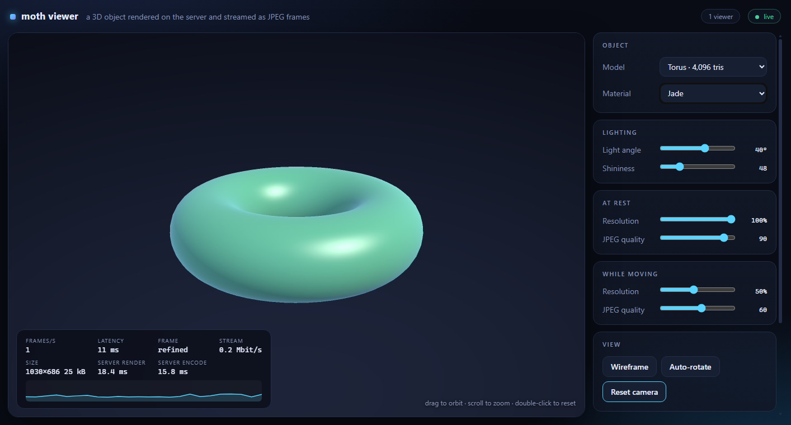

# moth2

A small Rust/WebAssembly UI framework for people who think of a page as a **tree of objects that own their children and clean up in their destructors**, the way a Qt or WPF application does, rather than as a function that re-renders a virtual DOM.

- Components are Rust values. A parent owns its children; **`Drop` removes a component's element and listeners**. Nothing looks anything up by id and nothing can dangle, whatever order things are dropped in.
- There is no virtual DOM. Changing a property writes the DOM element it is bound to.
- Every component is a real **Web Component** (custom element with a Shadow DOM, a `<template>`, slots, `::part()` styling, `ElementInternals` for forms), so it can also be written in plain HTML.
- The only JavaScript you do not generate is one generic shim of about 50 lines (`moth/src/shim.js`), which never changes when you add components; the rest is what `wasm-bindgen` generates.

moth2 rethinks [the C++ version of moth](https://github.com/arnaud-sintes/moth/tree/cpp-final) (this repository's history up to the tag `cpp-final`), a C++/emscripten framework with the same goals, whose lifetime handling never delivered its promise (see [its audit](docs/audit-of-the-cpp-version.md)). **It targets Chromium (Chrome, Edge) only.** It is version 0.1.0 and not published: use it by path, and expect the API to move. Licensed under MIT or Apache-2.0 at your option ([LICENSE-MIT](LICENSE-MIT), [LICENSE-APACHE](LICENSE-APACHE)). How and why it is built, what is guaranteed and what is not, and what is still open: [DESIGN.md](DESIGN.md).

## Quick start

You need Rust with the wasm target and [trunk](https://trunk-rs.github.io/trunk/):

```
rustup target add wasm32-unknown-unknown
cargo install trunk --locked
```

The quickest start is to copy [`templates/hello`](templates/hello) (a page, a callback and a little CSS; change the `moth` path in its `Cargo.toml`) and run `trunk serve`. By hand, a project is a binary crate (`Cargo.toml` with `moth = { path = "path/to/moth2/moth" }`), an `index.html` that trunk builds from, and a `main`:

```html
<!doctype html>
<html lang="en">
	<head>
		<meta charset="utf-8">
		<link data-trunk rel="rust" href="Cargo.toml">
	</head>
	<body></body>
</html>
```

```rust
use std::{cell::Cell, rc::Rc};

use moth::{Body, Label, PushButton};

/// The page owns its components: dropping it removes them from the DOM.
struct Page {
	_body: Body,
	_label: Label,
	_button: PushButton,
}

fn main() {
	moth::init(); // panics go to the browser console, with their file and line
	let body = Body::new().unwrap();
	let label = Label::new(&body, "Hello world").unwrap();

	// callbacks capture a non-owning handle, never the components themselves
	let text = label.text_handle();
	let clicks = Rc::new(Cell::new(0));
	let button = PushButton::new(&body, "Say hi", move || {
		clicks.set(clicks.get() + 1);
		text.set(format!("Hello world x{}", clicks.get()));
	})
	.unwrap();

	// keep the page alive until the browser tab goes away
	moth::mount(Page { _body: body, _label: label, _button: button }).unwrap();
}
```

`trunk serve` builds it and serves it. `init` makes panics readable in the browser console. `Body` is the root; everything else is created under a parent. `mount` keeps the page alive and drops it when the browser tab goes away (the one moment Rust cannot run destructors by itself).

## Guides

- [Getting started](docs/getting-started.md): the starting project explained, the dependencies you may need, release builds, testing, and a table of the problems people meet first.
- [Tutorial](docs/tutorial.md): a shopping-list application built step by step: a model the page follows, a list kept in step with it, a component made of components.
- [Writing components](docs/components.md): composing, making an element of your own with its own template and styles, and making one for pages written in HTML.
- [Styling](docs/styling.md): what page CSS reaches, the CSS variables and `::part()` names of every component, and what does not work.
- The API reference: `cargo doc -p moth --all-features --open`. Every public item is documented.
- [DESIGN.md](DESIGN.md) is the design and verification record, for maintainers.

The code in the guides is compiled and run by the test suite, like the examples below.

## Ownership

```rust
use moth::{Body, Component, Label, Panel};

fn main() {
	let body = Body::new().unwrap();
	let list = Panel::new(&body).unwrap();
	let mut rows: Vec<Label> =
		(1..=3).map(|n| Label::new(&list, &format!("row {n}")).unwrap()).collect();

	// a component removes its own element when it is dropped
	let second = rows[1].element().clone();
	assert!(second.is_connected());
	rows.remove(1);
	assert!(!second.is_connected());

	// ...so dropping the parent first is just as safe: nothing looks anything up by id
	drop(list);
	drop(rows);
}
```

A component holds its children and removes only its own element. Because components keep element references, not ids, and removing a detached element does nothing, no drop order can fail. A callback that has to reach a component captures a **weak handle** (`text_handle()`, `enabled_handle()`, `SliderHandle`, `SocketHandle`...): it reports that its owner is gone instead of touching it.

## Properties

Every component's state is a `Prop<T>`: a value with bindings that write the DOM. Setting a prop to the value it has does nothing; setting one from inside a binding is queued and applied after the running pass, so bindings see values in order and nothing is borrowed while your code runs. `Prop::bind` lasts as long as the prop; `bind_scoped` returns a `Subscription` that removes the binding when dropped.

`enabled` exists on every component and *is* the `disabled` attribute of its element. A component is effectively enabled when it and every ancestor are, a rule handlers check against the DOM at the time of the event, so a disabled panel disables everything in it, including a programmatic `click()`.

## Events

```rust
use moth::{Body, Component, Label, Panel, ToggleButton, event_detail, events};

fn main() {
	let body = Body::new().unwrap();
	let panel = Panel::new(&body).unwrap();
	let status = Label::new(&body, "off").unwrap();

	// the toggle knows nothing about the panel that holds it or the label that reports on it...
	let power = ToggleButton::new(&panel, "Power", |_| {}).unwrap();

	// ...it raises a bubbling, composed event that any ancestor (or script in the page) can hear
	let text = status.text_handle();
	let listener = panel
		.on(events::TOGGLE, move |event| {
			let on = event_detail(&event).and_then(|detail| detail.as_bool()).unwrap_or(false);
			text.set(if on { "on" } else { "off" }.to_owned());
		})
		.unwrap();

	// components raise their own the same way: `component.emit("my-event", &detail)`
	moth::mount((body, panel, status, power, listener)).unwrap();
}
```

Children talk to whoever contains them through DOM events: `emit` raises a bubbling, composed `CustomEvent`, `on` listens (to the component's own and to those bubbling up from inside it) and stops when its `Listener` is dropped. The stock components raise `events::TOGGLE` (a toggle button was clicked; `detail` is the state) and `events::SELECT` (a dropdown choice); buttons and text inputs need none, since `click` and `input` already cross shadow roots.

## Lists

```rust
use moth::{Body, Component, ElementRef, Keyed, Label, Panel};

struct Todo {
	id: u32,
	text: &'static str,
}

fn main() {
	let body = Body::new().unwrap();
	let list = Panel::new(&body).unwrap();
	let parent = ElementRef::new(list.element());
	let mut rows: Keyed<u32, Label> = Keyed::new();

	// make the rows match the items: new ids get a row, vanished ids drop theirs, the rest are
	// updated in place and moved only if they must be
	let mut show = |todos: &[Todo]| {
		rows.sync(
			list.element(),
			todos,
			|todo| todo.id,
			|todo| Label::new(&parent, todo.text),
			|row, todo| row.set_text(todo.text),
		)
		.unwrap();
	};
	show(&[Todo { id: 1, text: "milk" }, Todo { id: 2, text: "eggs" }]);
	show(&[Todo { id: 2, text: "free-range eggs" }, Todo { id: 3, text: "bread" }]);

	assert_eq!(list.element().text_content().as_deref(), Some("free-range eggsbread"));
}
```

`Keyed::sync` makes components mirror a list of items by key. A vanished key drops its component (this is where destructors pay off), a kept one is updated and moved only if it has to be, so focus and selection in a row survive the others changing. Foreign siblings in the parent are left alone.

## Markup

The same components work in HTML. Elements already in the page are upgraded by `define_all`; Rust owns the *component*, the DOM owns the *element*, so the component is dropped when its element is removed from the page for good.

```html
<section id="settings">
	<moth-label id="title" text="Settings"></moth-label>
	<moth-slider id="volume" min="0" max="10" value="3"></moth-slider>
	<moth-push-button id="reset">Reset</moth-push-button>
</section>
```

```rust
use moth::{Declarative, ElementRef, Label, Slider};

fn main() {
	// make the stock elements work in markup; those already in the page are upgraded
	moth::define_all().unwrap();

	// typed access to what the page declared (the DOM owns these: it ends with the element)
	let title = Label::of(ElementRef::by_id("title").unwrap().element()).unwrap();
	let volume = ElementRef::by_id("volume").unwrap().declared::<Slider>().unwrap();
	title.with(|title| title.set_text("Sound settings"));

	// behaviour for an element that is already there, gone when its owner drops the listener
	let reset = ElementRef::by_id("reset").unwrap();
	let click = reset
		.on("click", move |_| {
			volume.with(|slider| slider.set_value(3.0));
		})
		.unwrap();
	moth::mount(click).unwrap();
}
```

In markup the stock elements are driven by attributes (`text`, `value`, `min`, `max`, `toggled`, `disabled`...), and their events are DOM events. To react from Rust, listen with `ElementRef::on`, or reach the component with `Declarative::of` / `ElementRef::declared`, which return a non-owning `Declared` that stops working when the element goes. Your own component implements `Declarative` (see `moth/tests/adopt.rs`) and gets the same treatment.

## Components

| Rust | In markup | Notes |
|---|---|---|
| `Body` | | the root, attached to `<body>` |
| `Panel` | `<moth-panel>` | container; lay it out with CSS (`--moth-panel-display`, `--moth-panel-gap`) |
| `Label` | `<moth-label text>` | text in its own text node, so child components are never wiped |
| `PushButton` | `<moth-push-button>` | callback not called while disabled |
| `ToggleButton` | `<moth-toggle-button toggled>` | `controlled` mode: it only requests, the owner decides |
| `Image` | `<moth-image src alt>` | |
| `Edit`, `Slider`, `Dropdown` | `<moth-edit>`, `<moth-slider>` | form-associated: submitted under their `name`, nothing while disabled |
| `ProgressBar` | `<moth-progress-bar>` | |
| `Canvas` | | 2D; sized by CSS, sharp at any pixel ratio, redraws coalesced per frame |

Style them from outside with CSS custom properties (`--moth-button-radius`, `--moth-input-border`, `--moth-accent`...) and `::part()`.

## Talking to a server

`WebSocket` is an RAII client: its callbacks stop when it is dropped, and sending on a socket that is not open is an error instead of a silent loss. For state that lives on a server, the `replication` feature adds `Replica<M>` (the page's copy of a model it never edits), `Link` (a socket carrying whole-model snapshots one way and serde actions the other, with reconnection and exponential backoff) and bindings that run only when the field they select changes. The page is an empty shell: a click becomes an action, the server answers with the new model, and the components follow it. [samples/todo](samples/todo) is a shared todo list built that way, with two browsers staying in sync; [samples/back-end](samples/back-end) is the axum server for both samples.

## Samples and tests

```
cd samples/front-end && trunk build        # and the same in samples/todo and samples/viewer
cargo run -p moth-sample-back-end          # http://127.0.0.1:2000/  /todo/  /viewer/
```

### The 3D viewer



[samples/viewer](samples/viewer) shows what the back-end can do beyond small JSON: the server rasterizes a 3D object on its CPU cores and streams the result as JPEG frames over the same kind of WebSocket. Drag to orbit, scroll to zoom, double-click to reset; the model, material and lighting are dropdowns and sliders from the library, and the overlay shows frame rate, latency and server render/encode time.

**One server, one scene.** Like the todo list, the viewer's state lives on the server: everyone connected to the same URL steers and sees the same object, camera and lighting, so two tabs open on it stay in step (drag in one, watch the other turn; start the turntable in one, both spin). What stays a browser's own is the size of its frames and its resolution setting. For independent sessions run another server on another port (`--port`), there is no room or session id to manage.

- a page only *asks* for changes, as a patch holding just what changed, so two people changing different things both get their way, and for the same thing the later change wins; it then shows what the server announces (its dropdowns, sliders and toggles follow, without echoing back)
- the server turns the turntable, so it turns for everyone
- each viewer is sent only the **newest** state, never a backlog, and at most **two frames are in flight** (the page acknowledges each frame), so a slow connection slows its own stream and nobody else's
- the server renders as **few times as the screens allow**: viewers of the same size share one rendering and its compressed frames, a somewhat smaller screen of the same shape is served from that rendering, reduced before it is compressed, and only a very different one (another shape, or much smaller) is rendered for separately
- while the scene moves you get fast, smaller previews; when it rests one full-size, anti-aliased frame follows. Each browser has its own settings for both, four sliders in two cards: the size and the JPEG quality of the full frame ("At rest") and of the previews ("While moving"), so bandwidth can be traded for sharpness separately when the picture rests and when it moves
- every number from a page is untrusted: sizes, angles and settings are clamped on the server

Frames are binary WebSocket messages next to the JSON snapshots that replicate the scene, the list of models and the number of viewers (`LinkEvent::Binary`). [DESIGN.md](DESIGN.md#3d-viewer) has the protocol and what was measured.

### Tests

The tests run in a real browser (headless Edge through WebDriver); the scripts need `msedgedriver` matching your Edge and `wasm-bindgen-cli` matching the crate (see [DESIGN.md](DESIGN.md#dev-setup)):

```
.\scripts	est-wasm.ps1     # the library's tests
.\scripts\e2e.ps1           # the streaming sample, driven with real clicks
.\scripts\e2e-todo.ps1      # the todo sample: two browsers, a killed and restarted server
.\scripts\e2e-viewer.ps1    # the viewer: raw protocol, a scene shared by several clients, then several browsers (-Quick: about 70 s instead of 105 s)
cargo test -p moth-sample-protocol -p moth-sample-render -p moth-sample-back-end -p moth-sample-viewer   # the native tests
```

The code in this README is checked too: each example is a file in `moth/tests/readme/`, compiled and run by `moth/tests/readme.rs`, which also fails if the README stops containing it verbatim.
